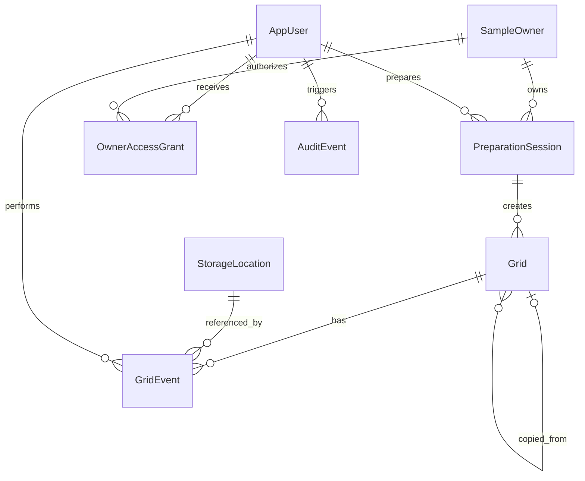

# Agreed database schema — v0.1

**Last reviewed:** 2026-11-04\
**Status:** Current preparation schema plus agreed future storage/lifecycle design

`registry/models.py` and its migrations define the implemented schema; the
[generated Grid field reference](#generated-grid-field-reference) below checks
its exact types. StorageLocation, GridEvent and their state transitions are still
designs, not deployed tables. Dated implementation notes record evolution; earlier
snapshot versions and precision limits are superseded by the current rules.

## 0. Read this first: invariants

1. A **preparation session** represents **one actual preparation/freezing session** and belongs to **exactly one sample owner**.
2. Normal session registration preserves **one immutable initial defaults snapshot**, copied to **independent values for each generated grid**. Imports preserve supplied original defaults or an explicitly unknown empty snapshot. Updating one grid never updates siblings or the snapshot.
3. **Experiment reference is optional**; optional project reference is descriptive only.
4. **Grid number is globally unique, permanent, and never reused**, regardless of owner/code changes. Historical `CCI-00001`-style IDs coexist with new owner-prefixed IDs (`kegu-1234` is illustrative).
5. Grids start **unclipped**, **not imaged**, and **awaiting storage**. Empty storage is valid at registration.
6. **Clipping state**, **availability/custody**, **imaging state**, and **current physical location** are different axes. Shipping does not imply imaging; imaging usually precedes disposal but never automatically proves it.
7. Physical lifecycle actions are captured in **append-only GridEvent records**. Database corrections/metadata edits are captured separately in **AuditEvent**.
8. All active CCI staff and facility superusers can view and edit all active grids. Archived grids are read-only; inactive accounts and non-CCI non-administrators cannot edit. Import separately requires the CCI flag even for superusers; export follows viewing access. Enforce this server-side.
9. Do not guess unknown scientific values, humidity scale or missing dates during import. The approved date-only rule explicitly uses noon in Europe/Stockholm and reports it; blank dates remain unknown.

## 1. Data relationships



**Conceptual domain entities:** `SampleOwner`, `PreparationSession`, `Grid`, planned
`StorageLocation`/`GridEvent`, `accounts.User` (AppUser in the diagram),
`OwnerAccessGrant`, and `AuditEvent`. The implemented preparation schema also has
`DeletedGrid`, `GridIdentifierCounter` and `PreparationSuggestion`. Copied-from
links are reserved in the model but have no current UI/Excel workflow.

Supporting tables (e.g. `ImportRun`, a locked `GridIdentifierCounter`, or Django auth group/permission tables) are permitted when needed for correctness. They do not alter the agreed domain model.

## 2. Field definitions

**Type legend:** `PK` primary key, `FK` foreign key, `?` nullable, `unique` unique constraint. `Decimal` means fixed-precision numeric storage, not binary float. `JSON` means validated structured data, not an unrestricted replacement for relational fields.

### 2.1 SampleOwner

| Field | Type | Constraints / purpose |
|---|---|---|
| `id` | bigint PK | Stable internal identity |
| `name` | string | Required; sample owner or research group label |
| `code` | string unique | Automatically assigned from name at registration; four lowercase letters/digits with a checked collision sequence; stable afterward. Future grid prefix use awaits numbering decision. |
| `affiliation` | string? | Optional institution/group |
| `notes` | text? | Optional |
| `active` | boolean | Default true; deactivate, don't hard-delete referenced owners |
| `created_at`, `updated_at` | timestamp | Automatic |

- The existing Excel `Name` is **not** an authenticated username.
- Changing a person's name or code **must not rewrite** existing grid numbers.
- New owner codes have four lowercase letters/digits, based on the first two letters of the first and last name, with numeric substitutions on collision. Existing codes are preserved. Grid numbering uses the confirmed per-owner sequence in section 10.

### 2.2 PreparationSession

| Field | Type | Constraints / purpose |
|---|---|---|
| `id` | bigint PK | Stable internal session identity |
| `owner_id` | FK SampleOwner | **Required**, exactly one owner per session |
| `prepared_by_id` | FK User? | Logged-in operator for normal registration; nullable for imports with unknown operator |
| `prepared_at` | timezone-aware datetime? | Required in normal registration; import may preserve an unknown date or apply the explicit date-only noon rule |
| `experiment_reference` | string? | Optional free text such as `JB002` |
| `project_reference` | string? | Optional, **not** an access-control boundary |
| `defaults_schema_version` | positive integer | Current default `7`; retained snapshots may have older versions |
| `defaults` | JSON object | **Immutable snapshot**; imported unknown defaults are `{}`, never inferred from grid values |
| `request_token` | unique UUID | Submission idempotency and portable Excel session identity; not the visible session number |
| `notes` | text? | Preparation-session observations |
| `created_at`, `updated_at` | timestamp | Automatic |

A session is an **actual laboratory event**, not merely a convenient batch import. Never infer that all grids belong to one session solely because they have the same owner or experiment reference.

**Snapshot format:** keys match `PREPARATION_FIELDS`; Decimal values are strings,
unknown numeric values are null and unknown text is empty text. Normal snapshots
are made at registration. Imported original snapshots stay separate from actual
grid values; when not supplied, `{}` explicitly means unknown. Do not make a live
template or infer defaults from the first imported row.

### 2.3 Grid (central scientific record)

| Field | Type | Constraint or meaning |
|---|---|---|
| `id` | bigint PK | Internal FK target |
| `grid_number` | string unique | **Immutable** public/natural ID, e.g. `CCI-00001`, `kegu-1234` |
| `session_id` | FK PreparationSession | Required; owner derived through session |
| `copied_from_grid_id` | self-FK? | Reserved optional relationship; no current UI/Excel workflow, never inferred |
| `sample_description` | text? | Existing `Sample` column |
| `sample_concentration_value` | Decimal? | Numeric concentration |
| `sample_concentration_unit` | string? | e.g., `mg/mL` |
| `buffer_description` | text? | Preserve complete free text, including pH and components |
| `grid_type` | string? | Human-readable grid type such as Quantifoil/mesh |
| `grid_box_number` | string? | Batch (Box/LOT-number); separate from physical storage |
| `carbon_description` | string? | Unknown, none, amorphous carbon, graphene oxide, or graphene |
| `carbon_thickness_nm` | Decimal? | Amorphous carbon thickness in nm; historical unknown-type nm values remain in nm |
| `carbon_thickness_layers` | integer? | Non-negative count of graphene or graphene oxide layers |
| `glow_device` | string? | Glow discharge device; blank means Unknown |
| `glow_atmosphere` | string? | Case-insensitive input, stored with capitalized words (e.g. `Air`) |
| `glow_polarity` | string? | Case-insensitive input, stored with capitalized words (e.g. `Negative`) |
| `glow_current_ma` | Decimal? | e.g., `15` |
| `glow_duration_s` | Decimal? | e.g., `20` |
| `freezing_device` | string? | Freezing device; blank means Unknown |
| `sample_volume_ul` | Decimal? | Existing `Amount` |
| `temperature_c` | Decimal? | e.g., `4` |
| `humidity_percent` | Decimal? | **Only fill after confirming source convention** |
| `blot_time_s` | Decimal? | Numeric duration |
| `hold_time_s` | Decimal? | Numeric duration |
| `drain_time_s` | Decimal? | Optional non-negative drain time in seconds |
| `blot_force` | Decimal? | Scale/unit requires clarification; raw source retained in import log |
| `multiple_blot` | non-negative integer | Multiple blots; default 0, blank input becomes 0, integer >= 0 |
| `notes` | text? | Individual remarks/observations, including historical copies/outcomes |
| `version` | positive integer | Optimistic concurrency; reject stale edits/archive confirmations |
| `created_at`, `updated_at` | timestamp | Automatic |

Do **not** put the latest storage location, clipping date, and imaging outcome into unrelated freely editable columns. They should be derived from or transactionally synchronized with `GridEvent` (read-only cache columns acceptable for high-performance tables).

For scientific traceability, a grid must retain its original source values via import logs/archived input when parsing is lossy or uncertain. No mandatory value should be imposed simply because the future system would prefer it if legacy rows lack it.

**Unknown convention:** Show Unknown for missing or unverified values, and allow
staff to correct them later. None explicitly means the material was absent; it is
not a synonym for Unknown. New-session forms prefill glow discharge Device with
Quorum – GloCube+ and freezing Device with Vitrobot Mark IV; either may be changed
or cleared. Existing grids and imports with no device remain Unknown, never
inferred from present-day equipment. New values are copied to each grid and the
original session snapshot. Screening for values needing review is tracked in #10.

### 2.4 StorageLocation

| Field | Type | Purpose |
|---|---|---|
| `id` | UUID or bigint PK | Internal identity |
| `location_code` | string unique | Canonical physical-position key; avoid SQL nullable-composite uniqueness pitfalls |
| `dewar` | string? | Dewar identifier |
| `cane` | string? | Cane identifier |
| `puck` | string? | Puck identifier |
| `puck_color` | string? | Puck color where used |
| `box` | string? | Box identifier |
| `slot` | string? | Grid slot; strings accommodate alphanumeric positions |
| `location_kind` | string? | Optional `unclipped`/`clipped` storage-layout descriptor |
| `notes` | text? | Optional |

- Use a canonical normalized path based on the **confirmed local storage hierarchy**. A position must identify one physically meaningful grid slot.
- The workbook has distinct unclipped and clipped location columns; both can map to this table, distinguished by event time and optionally `location_kind`.
- Do not enforce that every storage location has all five levels; different devices may use different hierarchy depths.
- A grid may have **no** current storage location, e.g. freshly prepared, removed, shipped, or discarded.
- Prevent **simultaneous assignment of two available grids to the same one-grid storage slot**, using transaction-safe constraints/service logic.

### 2.5 GridEvent (append-only physical history)

| Field | Type | Purpose |
|---|---|---|
| `id` | UUID or bigint PK | Event identity |
| `grid_id` | FK Grid | Required |
| `event_type` | enum/string | `stored`, `moved`, `clipped`, `removed_for_imaging`, `imaged`, `returned_to_storage`, `shipped`, `discarded` |
| `occurred_at` | timezone-aware datetime? | Required for new events; **nullable for legacy unknown event time** |
| `recorded_at` | timestamp | Automatic timestamp when entered/imported |
| `performed_by_id` | FK AppUser? | Required for new events where recorded by staff; nullable for historical imports |
| `from_location_id` | FK StorageLocation? | Where appropriate |
| `to_location_id` | FK StorageLocation? | Where appropriate |
| `destination` | text? | External recipient/site when shipped |
| `details` | validated JSON object? | Minimal event-specific metadata, e.g. instrument reference; avoid dumping core fields into arbitrary JSON |
| `notes` | text? | Optional |
| `source_import_reference` | string? | Links legacy import evidence when applicable |

**Core event semantics:**

- `stored`: assign grid to first confirmed storage position.
- `moved`: change storage position with recorded `from` and `to`.
- `clipped`: change clipping state; may include physical move to a clipped-compatible location in the same atomic action.
- `removed_for_imaging`: grid leaves a storage position for imaging; optionally retains its last-known location separately in history.
- `imaged`: records imaging, without assuming disposal. Multiple imaging events may be possible unless later operational rules forbid them.
- `returned_to_storage`: record that a removed grid is back in a valid location.
- `shipped`: removes grid from CCI custody; records destination and date where known. Does not mean disposed or imaged.
- `discarded`: marks grid no longer available. Discard can happen without imaging.

**Append-only** means records are not overwritten/deleted as routine operations. Any exceptional correction should be separately audited, and a later release can add explicit event reversal/correction mechanics if necessary.

### 2.6 AppUser

The implemented `accounts.User(AbstractUser)` has a stable bigint key and was set
before the first migration. It retains Django's login/password/active fields and
adds `is_cci_staff`. Django's `is_staff` is labelled Administration site access;
facility-wide administration requires `is_superuser`. Keep sample ownership in
`SampleOwner`, separate from login identities.

Identity is **separate from authorization**. Use local accounts initially; permit external SSO/OIDC later through a pluggable backend while retaining same internal user IDs and access grants.

### 2.7 OwnerAccessGrant

| Field | Type | Constraint |
|---|---|---|
| `id` | PK | |
| `user_id` | FK AppUser | Required |
| `owner_id` | FK SampleOwner | Required |
| `role` | enum/string | Current choices `viewer`, `operator`, `editor`; future external-action policy is undecided |
| `created_at`, `updated_at` | timestamp | Automatic |

- Unique constraint on `(user_id, owner_id)`.
- Admins manage accounts and owner profiles. Active CCI staff have facility-wide
  read/edit/import/export access to active grids; archived records remain read-only.
- Owner-based grants are retained for future external access. They do not limit
  internal CCI staff, and new owner registration no longer creates them.
- Enforce staff status and archive restrictions server-side on every write.

### 2.8 AuditEvent

| Field | Type | Purpose |
|---|---|---|
| `id` | PK | |
| `actor_id` | FK AppUser? | Nullable for automated/system/import tasks |
| `entity_type` | string | e.g. `Grid`, `PreparationSession`, `SampleOwner`, `OwnerAccessGrant` |
| `entity_id` | string/UUID | Record identity |
| `operation` | string | `create`, `update`, `deactivate`, `import`, `grant`, etc. |
| `changes` | JSON | Explicit before/after values, excluding secrets |
| `recorded_at` | timestamp | Automatic |
| `source` | string? | UI/API/import/system, optional |

Audit events are not the physical lifecycle: correcting a concentration or owner name is **not** a `GridEvent`.

## 3. Status model / valid transitions

The application should compute or transactionally maintain **independent state axes**:

| Axis | Values | Source |
|---|---|---|
| `clip_state` | `unclipped`, `clipped` | Starts unclipped; changes at `clipped` event |
| `availability` | `awaiting_storage`, `in_storage`, `removed_for_imaging`, `off_site`, `discarded` | Derived from latest applicable events |
| `imaging_state` | `not_imaged`, `imaged` | Imaging events; does not imply disposal |
| `current_location` | StorageLocation or null | Derived from storage/retrieval/shipping/disposal events |

Example legal paths (not exhaustive):

```text
New grid (unclipped, awaiting_storage, not_imaged)
  -> stored -> in_storage
  -> moved -> in_storage
  -> clipped [optionally relocates, preserving history]
  -> removed_for_imaging -> imaged -> discarded
  -> shipped -> off_site

Stored -> discarded                         # failed grid without imaging
Stored -> shipped                           # sent for off-site imaging
Removed_for_imaging -> returned_to_storage  # uncommon but must remain possible
Off_site -> returned_to_storage             # potential future support; not core v0.1 flow
```

Never assume that grid image acquisition at another site or all disposal actions are known. Decide exceptional transition rules through tests, not ad-hoc user edits.

**Potential cached projection fields:** `Grid.current_location_id`, `Grid.current_availability`, `Grid.current_clip_state`, `Grid.is_imaged`, `Grid.last_event_at`. These are **read-only projections**, changed only with event writes inside one DB transaction. Alternatively derive them in queries if initial volume remains small.

## 4. Constraints and service-layer rules

- `grid_number`: nonblank, case-normalized unique, immutable after first save; no recycle of deleted identifiers.
- New grid IDs: allocate under a DB transaction with a locked per-prefix counter (or equivalent PostgreSQL-safe mechanism). Preview is provisional until confirmation; no collision during concurrent creation.
- Session registration: one owner, a nonnegative/positive sensible grid count, validated shared fields; grids and snapshot all created atomically.
- Validation: no negative durations/volumes/concentrations, `0 <= humidity_percent <= 100` when known; nullable for unknowns; explicit units.
- Storage: prevent simultaneous slot occupancy; prevent moving stored grids to invalid/occupied destinations; don't allow a discarded grid to be treated as available through a generic edit.
- Clipping: cannot clip an already clipped grid unless explicitly correcting history; avoid impossible sequences.
- `shipped`/`discarded`: exclude from default available inventory but do not delete.
- For new physical events require acting authenticated user and event time; historical imports can use unknown actor and date.
- Import: do not manufacture owner codes, session dates, or physical chronology without a declared rule or staff review.
- Admin/policy changes are audited; never log credentials or private session secrets.

## 5. Future extensions (not in v0.1)

- `Protocol`, `ProtocolVersion`, `PreparationAttempt` when expanding to broader LM/EM/cryo-EM protocol knowledge base.
- `GridObservation` (issue/outcome/evidence with source/provenance).
- OMERO image/dataset and OMERO.figure references.
- Local LLM extraction with source document checksum, schema version, review state, and evidence citation.
- External identity provider and researcher-specific limited actions.

## 6. Implementation guidance

Recommended implementation is Django models + PostgreSQL. Ensure Django system checks, database constraints, service tests, and migration tests. Exact choices (PK type, enum implementation, audit library, list grid UI) should be decided as part of implementation, not imposed silently by this conceptual schema.

## 7. Registration prototype implementation notes (2026-11-03)

The initial registration slice implements SampleOwner, PreparationSession, Grid,
OwnerAccessGrant, AuditEvent and GridIdentifierCounter, using bigint keys.
StorageLocation and GridEvent are deferred until the physical handling slice;
initial physical state is displayed read-only, with no editable status columns.

- New owner codes use four lowercase characters. The first and last words are
  the name parts: Rafael Silva → `rasi`; collision sequence is `rsi1`–`rsi9`,
  `rs10`–`rs99`, then `r100`–`r999`. Short parts are padded with `x`; one-word
  names supply their first four letters; accents are stripped and unavailable
  Latin letters are padded with `x`. If all candidates are occupied, allocation
  fails explicitly rather than creating duplicates or a longer code.
  The Generate button checks all owners, including inactive owners. Save rechecks
  under a short table lock and the database uniqueness constraint. An available
  displayed suggestion is preserved; occupied suggestions are replaced with the
  next candidate. Assigned codes stay fixed, and existing longer codes remain
  unchanged. The database retains a 40-character column for those legacy codes.
  Operational grid sequence rules were confirmed in D01 on 2026-11-04.
- Registration now uses the four-character sample-owner prefix and an independent
  per-owner sequence (see section 10). Existing DEMO IDs are preserved. Creation
  can be disabled with `GRID_REGISTRATION_ENABLED=false`. Operational ID preview
  remains future UI work; batches are limited to 1–100 grids in this prototype.
- Normal registration requires a timezone-aware preparation timestamp and records
  the authenticated operator. Current-format imports can preserve unknown dates
  or operators; original legacy grouping remains a separate future task.
- The original defaults schema version 1 used Grid preparation field names. Decimal values are
  strings in the JSON snapshot; unknown numeric/boolean values are JSON null.
  The original numeric columns had four fractional places (concentration: three);
  current columns use two places and new snapshots use version 4 (section 12).
  Unknown text is empty text; a numeric concentration requires an explicit unit.
- Grid creation, counter changes and audit entries commit or roll back together.
  A unique request token makes repeated identical submissions idempotent.
- Individual edits use a version field to reject stale saves. PostgreSQL triggers
  protect IDs/session membership, initial defaults and append-only audit history,
  including bulk ORM mutations. Generic admin cannot edit scientific records.
- Active CCI staff may register new owners without automatic grants, create
  sessions for any active owner, and edit every active grid. Operator identity
  records attribution, not edit rights. Archived records remain read-only.
  Existing-owner/account/grant administration remains superuser-only. The retained
  OwnerAccessGrant model is reserved for a future external-access policy.


These implementation choices preserve the conceptual model. The legacy grouping
representation and correction workflow in the import specification remain open
before the importer is implemented; they are not silently settled by this slice.

## 8. Preparation entry and registry refinement (2026-11-03)

- Add optional `Grid.grid_box_number` beside grid type. This describes the source
  grid box used for preparation and is not a StorageLocation. Legacy parenthetical
  references were originally retained in `grid_type_reference`; that field was
  subsequently removed following staff feedback and D05 remains open.
- This slice introduced defaults schema version 2, the box field and a
  three-decimal concentration limit. Later refinements below supersede that
  version and precision policy. This original migration rejects meaningful
  excess concentration digits; the later two-decimal migration rounds disposable
  test data with explicit approval.
- `PreparationSuggestion` is supporting vocabulary, with field name/value pairs
  and private source provenance. It is not evidence of a physical grid, session,
  verified scientific relationship or state transition. Seeding is dry-run
  capable, idempotent and audited. Current grid values and remembered short values
  supply reusable suggestions; novel entries remain permitted.
- Registry columns and filters share an explicit property allowlist. Display
  choices stay in per-account browser preferences; filtering runs server-side on
  typed fields. Numeric ranges use Decimal and inclusive bounds. Unknown values
  do not become numeric zero. All applied conditions combine with AND.

## 9. Owner visibility and session registration (2026-11-04)

All active CCI staff can view every owner in the owner directory, including
inactive owners, and register new owners. The session selector shows all active
owners regardless of creator or grants. Session creation does not confer an
owner-wide grant. The later shared-editing decision supersedes the original
operator/Editor restriction: every active CCI staff member may edit every active
grid, including grids of inactive owners. Inactive owners cannot receive new
preparation sessions through normal registration. Inactive users cannot register,
import or edit. Existing-owner administration remains admin-only. No automatic
Editor grants are created; previously stored grants are retained but do not
restrict or expand internal CCI editing rights.

## 10. Confirmed owner-based grid IDs (2026-11-04)

New IDs are `<owner.code>-<suffix>`, using exactly four lowercase letters/digits
for the owner code. The suffix starts at `0001`, continues to `9999`, then uses
`a001` through `a999`, `b001` through `b999`, through `z999` (35,973 values per
owner). There is no `0000`, `a000`, wraparound or automatic suffix-length change.
The order represents successful database generation within that owner, independently
of preparation timestamps or sequences belonging to other owners.

The service locks the SampleOwner row before creating/reading its stable
`GridIdentifierCounter` namespace (`owner:<internal owner PK>`). Matching existing
IDs contribute to the high-water mark, including recognized uppercase historical
variants. This reserves existing identifiers without renaming them. The counter,
session, grids and audit events share one transaction; failed batches consume no
IDs, and retries return the original batch even when the sequence is exhausted.
If the requested batch exceeds available space, creation fails before inserting
the session. Existing `CCI-…`, `DEMO-…` and other legacy formats remain immutable.
No new physical grids are created from blank workbook identifiers.

Legacy owner codes longer than four characters remain unchanged; generation for
those owners fails explicitly pending a separate audited correction decision.
The old DEMO counter is retained as historical setup data and no longer allocated.

## 11. Preparation wording and blot counts (2026-11-04)

Carbon description is trimmed and casefolded (`No` and `no` both become `no`).
Glow atmosphere and polarity are trimmed and title-cased (`air` becomes `Air`,
`negative` becomes `Negative`); other scientific text is not case-normalized.
Suggestions use the same normalization so casing alone does not create duplicates.

Remove the active `humidity_raw` field. Humidity percentage remains optional;
ambiguous Excel humidity is not converted or suggested. Replace `double_blot`
with `multiple_blot`, validated as a non-negative integer in forms, services
and the database. The label is Multiple blots; default/blank is 0. Negatives,
fractions and booleans are rejected by the application. This is a numeric registry property.

The user explicitly confirmed existing data is disposable test data and does not
need historical preservation for this change. Migration 0006 removes retired
columns, snapshot/audit keys and vocabulary entries without archival; existing
blot values reset to the explicitly requested default 0, without interpreting the old boolean. It
normalizes existing wording, advances snapshots to schema version 3, and increments
grid versions so pre-migration forms cannot silently overwrite the changed schema.
Snapshot/audit triggers are suspended only within that atomic migration and are
restored afterward. This is a scoped prototype exception, not a general policy
for altering scientific history after production use.

## 12. Two-place measurements and generated field reference (2026-11-04)

All Grid DecimalFields now use scale 2: `numeric(12,2)` for measurements other
than humidity, which uses `numeric(7,2)`. The user explicitly authorized rounding
existing disposable test data. Migration 0007 lets PostgreSQL round those numeric
columns and rounds/deduplicates their old numeric suggestions. Existing session
snapshots stay unchanged; new snapshots use schema version 4. New form/service
input with excess precision is rejected rather than silently rounded.

The registry Preparation date column renders only the local date, retaining the
full timestamp in storage and session details. This changes presentation, not type.

The Django Grid model is the single authoritative field definition. The following
table is generated with `python manage.py describe_grid_fields --update-docs`;
`python dev.py check` detects drift. Application defaults and model validators are
not necessarily PostgreSQL defaults/check constraints. Refer to the invariant and
service descriptions above for cross-field, authorization and immutability rules.

### Generated Grid field reference

<!-- generated-grid-fields:start -->
| Field | PostgreSQL type | NULL allowed | Empty text allowed | Application default | Model bounds |
|---|---|---|---|---|---|
| `id` | `bigint` | No | No | Generated ID | >= -9223372036854775808, <= 9223372036854775807 |
| `grid_number` | `varchar(80)` | No | No | — | — |
| `session_id` | `bigint` | No | No | — | — |
| `copied_from_grid_id` | `bigint` | Yes | No | — | — |
| `sample_description` | `text` | No | Yes | — | — |
| `sample_concentration_value` | `numeric(12, 2)` | Yes | No | — | >= 0 |
| `sample_concentration_unit` | `varchar(40)` | No | Yes | — | — |
| `buffer_description` | `text` | No | Yes | — | — |
| `grid_type` | `varchar(200)` | No | Yes | — | — |
| `grid_box_number` | `varchar(100)` | No | Yes | — | — |
| `carbon_description` | `varchar(200)` | No | Yes | — | — |
| `carbon_thickness_nm` | `numeric(12, 2)` | Yes | No | — | >= 0 |
| `carbon_thickness_layers` | `integer` | Yes | No | — | >= 0, <= 2147483647 |
| `glow_device` | `varchar(200)` | No | Yes | — | — |
| `glow_atmosphere` | `varchar(100)` | No | Yes | — | — |
| `glow_polarity` | `varchar(100)` | No | Yes | — | — |
| `glow_current_ma` | `numeric(12, 2)` | Yes | No | — | — |
| `glow_duration_s` | `numeric(12, 2)` | Yes | No | — | >= 0 |
| `freezing_device` | `varchar(200)` | No | Yes | — | — |
| `sample_volume_ul` | `numeric(12, 2)` | Yes | No | — | >= 0 |
| `temperature_c` | `numeric(12, 2)` | Yes | No | — | — |
| `humidity_percent` | `numeric(7, 2)` | Yes | No | — | >= 0, <= 100 |
| `blot_time_s` | `numeric(12, 2)` | Yes | No | — | >= 0 |
| `hold_time_s` | `numeric(12, 2)` | Yes | No | — | >= 0 |
| `drain_time_s` | `numeric(12, 2)` | Yes | No | — | >= 0 |
| `blot_force` | `numeric(12, 2)` | Yes | No | — | — |
| `multiple_blot` | `integer` | No | No | 0 | >= 0, <= 2147483647 |
| `notes` | `text` | No | Yes | — | — |
| `version` | `integer` | No | No | 1 | >= 0, <= 2147483647 |
| `created_at` | `timestamp with time zone` | No | No | Time of creation | — |
| `updated_at` | `timestamp with time zone` | No | No | Time of save | — |
<!-- generated-grid-fields:end -->

## Session labels and browsing (2026-11-04)

PreparationSession.display_name derives `Session <internal ID> - <owner code> -
<YYMMDD>` from existing fields. The date is the preparation date in the facility's
default timezone, not the entry date or viewer timezone. Missing historical dates
use `undated`. This is presentation only: no additional name column or replacement
primary key is introduced. Session/grid detail links use the same central label.

All active CCI staff can browse all sessions, with owner, operator, reference and
inclusive date filters, grid counts and pagination. Existing editing permissions
are unaffected. Grid scientific values and session timestamps are not modified by
naming or browsing.

## Password-confirmed grid deletion archive (2026-11-04)

The Delete action is an audited record correction, separate from physical
GridEvent disposal. Any active CCI staff member (or facility superuser) may archive
one grid after reviewing its displayed ID/owner/session and re-entering their own
current local password. No additional ID entry is required. Owner edit grants are not required for this distinct action. CSRF and an
expected-version check protect the confirmation; repeated successful submissions
are idempotent and still require the password.

A supporting `DeletedGrid` table holds an immutable one-to-one Grid reference,
required `deleted_by` user reference, `deleted_at` timestamp and internal primary
key. The original Grid row is retained, rather than copying scientific records to
a second physical database. Original snapshots and AuditEvents remain intact.
Archival increments the grid's edit version and records an archive AuditEvent in
one transaction. A failure rolls back marker, version and audit together.

`Grid.objects` deliberately includes active and archived rows so global ID
uniqueness, counter high-water marks, lineage links and original-batch retry
checks retain historical context. Operational views use `.active()` explicitly;
`.archived()` selects deleted records. Session displays/counts show active grids
with separate archive counts/links. The archive is visible read-only to all CCI
staff. Scientific edits and normal admin Grid views exclude archived records.
PostgreSQL guards reject updates to archived grids and modification/deletion of
archive markers, while existing hard-delete and immutable-ID protections remain.

Passwords are checked server-side against the current acting account and are
never persisted in archive/audit data. Accounts without a local password cannot
use this confirmation flow. A later SSO deployment needs its own reauthentication
mechanism. Restore/permanent purge tools are deferred; any eventual purge must
keep identifier reservations and respect lineage/history dependencies. No bulk
deletion is introduced. No physical discard or storage transition is inferred.

## 15. Current-format Excel transfer and shared editing (2026-11-04)

All active CCI staff may export/import and edit all active grids. Operator identity
is scientific attribution. AuditEvent records who entered/corrected/imported each
record, its entry time, and preparation before/after changes. No new automatic
owner grants are needed. Future external access still needs an explicit policy.

Import permission explicitly requires the CCI staff flag, including for facility
administrators. Export follows the registry's existing viewing/row-access policy,
not import permission; this change grants no new browsing access. A shared
`visible_grids` boundary applies to browsing, filtering and direct Excel exports.

Excel transfer needs no schema change: the existing session request UUID is its
portable key, hidden in supporting export metadata; owner code and immutable grid number are the other natural keys.
Supporting worksheets preserve owner profiles and original defaults separately
from grid actual values. Existing records must match exactly after typed input
validation; import never updates or unarchives records. Owner/session/grid inserts
and their source/audit records are atomic. Original exported operator strings and
row values are retained in import provenance even when no local operator matches.
Full audit history and physical events are not transferred by this format.


Hand-entered workbooks use plain, file-local Session labels. No UUID or defaults
JSON is required. Explicitly labelled groups without existing IDs receive new
UUIDs and an unknown empty defaults snapshot. Re-import can resolve an explicitly
labelled group through its existing grid IDs, but cannot merge distinct existing
sessions. Exported UUIDs remain authoritative when supporting metadata is present.
