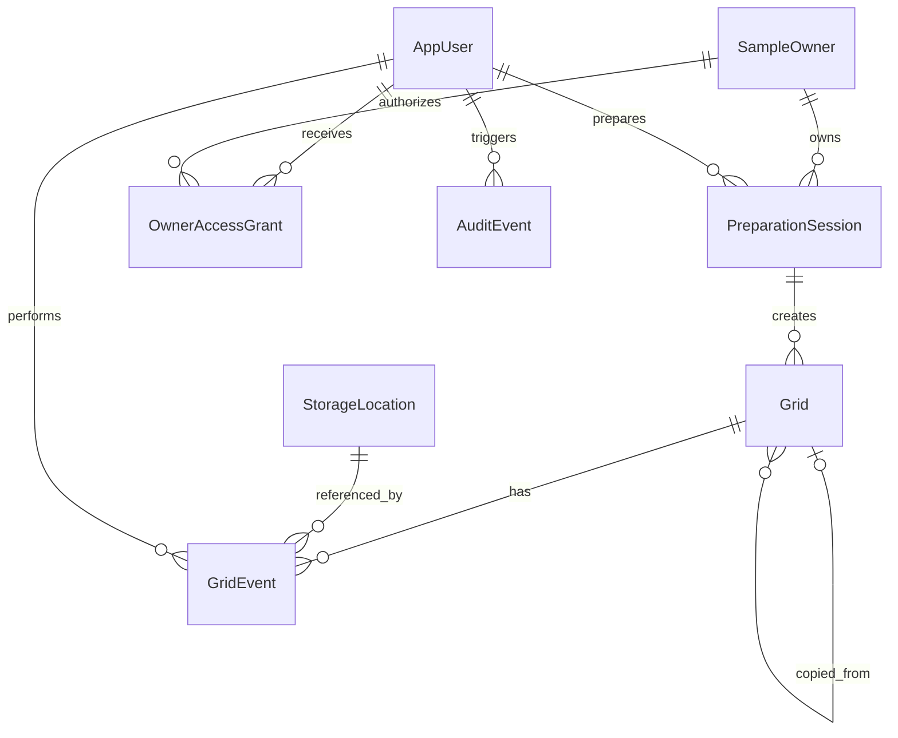

# Agreed database schema — v0.1

**Date:** 2026-11-02  
**Status:** Agreed conceptual schema; physical table names and selected field details may evolve in migrations.

## 0. Read this first: invariants

1. A **preparation session** represents **one actual preparation/freezing session** and belongs to **exactly one sample owner**.
2. Every new session preserves **one immutable initial defaults snapshot**, copied to **independent values for each generated grid**. Updating one grid never updates siblings or the snapshot.
3. **Experiment reference is optional**; optional project reference is descriptive only.
4. **Grid number is globally unique, permanent, and never reused**, regardless of owner/code changes. Historical `CCI-00001`-style IDs coexist with new owner-prefixed IDs (`kegu-1234` is illustrative).
5. Grids start **unclipped**, **not imaged**, and **awaiting storage**. Empty storage is valid at registration.
6. **Clipping state**, **availability/custody**, **imaging state**, and **current physical location** are different axes. Shipping does not imply imaging; imaging usually precedes disposal but never automatically proves it.
7. Physical lifecycle actions are captured in **append-only GridEvent records**. Database corrections/metadata edits are captured separately in **AuditEvent**.
8. All CCI staff can read all grids. Owner-level write permissions must be enforced server-side (subject to final staff editing policy). Only CCI staff are onboarded initially.
9. Don't infer any scientific value (including humidity scale and missing dates) during import.

## 1. Data relationships



**Eight primary entities:** `SampleOwner`, `PreparationSession`, `Grid`, `StorageLocation`, `GridEvent`, `AppUser`, `OwnerAccessGrant`, and `AuditEvent`.

Supporting tables (e.g. `ImportRun`, a locked `GridIdentifierCounter`, or Django auth group/permission tables) are permitted when needed for correctness. They do not alter the agreed domain model.

## 2. Field definitions

**Type legend:** `PK` primary key, `FK` foreign key, `?` nullable, `unique` unique constraint. `Decimal` means fixed-precision numeric storage, not binary float. `JSON` means validated structured data, not an unrestricted replacement for relational fields.

### 2.1 SampleOwner

| Field | Type | Constraints / purpose |
|---|---|---|
| `id` | UUID or bigint PK | Stable internal identity |
| `name` | string | Required; sample owner or research group label |
| `code` | string unique | Automatically assigned from name at registration; four lowercase letters/digits with a checked collision sequence; stable afterward. Future grid prefix use awaits numbering decision. |
| `affiliation` | string? | Optional institution/group |
| `notes` | text? | Optional |
| `active` | boolean | Default true; deactivate, don't hard-delete referenced owners |
| `created_at`, `updated_at` | timestamp | Automatic |

- The existing Excel `Name` is **not** an authenticated username.
- Changing a person's name or code **must not rewrite** existing grid numbers.
- New owner codes have four lowercase letters/digits, based on the first two letters of the first and last name, with numeric substitutions on collision. Existing codes are preserved. Operational grid numbering remains a separate decision.

### 2.2 PreparationSession

| Field | Type | Constraints / purpose |
|---|---|---|
| `id` | UUID or bigint PK | Stable session identity |
| `owner_id` | FK SampleOwner | **Required**, exactly one owner per session |
| `prepared_by_id` | FK AppUser? | Required for new sessions; nullable for historical imports with unknown operator |
| `prepared_at` | timezone-aware datetime? | Required for new entries if agreed; nullable for legacy unknown dates |
| `experiment_reference` | string? | Optional free text such as `JB002` |
| `project_reference` | string? | Optional, **not** an access-control boundary |
| `defaults_schema_version` | positive integer | Version of initial parameter snapshot; start at `1` |
| `defaults` | JSON object | **Immutable snapshot** once grids created; initial shared parameters |
| `notes` | text? | Preparation-session observations |
| `created_at`, `updated_at` | timestamp | Automatic |

A session is an **actual laboratory event**, not merely a convenient batch import. Never infer that all grids belong to one session solely because they have the same owner or experiment reference.

**Snapshot format:** named parameter keys matching grid field concepts; types/units expressed using a documented schema. Could mirror the Grid preparation field names. Save the snapshot at creation, not as a live editable template; if another session is prepared with similar parameters, start a **new session** using a copied set of defaults.

### 2.3 Grid (central scientific record)

| Field | Type | Constraint or meaning |
|---|---|---|
| `id` | UUID or bigint PK | Internal FK target |
| `grid_number` | string unique | **Immutable** public/natural ID, e.g. `CCI-00001`, `kegu-1234` |
| `session_id` | FK PreparationSession | Required; owner derived through session |
| `copied_from_grid_id` | self-FK? | Optional explicit relationship, **not inferred** from similar content |
| `sample_description` | text? | Existing `Sample` column |
| `sample_concentration_value` | Decimal? | Numeric concentration |
| `sample_concentration_unit` | string? | e.g., `mg/mL` |
| `buffer_description` | text? | Preserve complete free text, including pH and components |
| `grid_type` | string? | Human-readable grid type such as Quantifoil/mesh |
| `grid_box_number` | string? | Preparation grid box number; separate from physical storage |
| `grid_type_reference` | string? | Parenthetical number; actual meaning needs confirmation |
| `carbon_description` | string? | e.g., `No`; can be further structured later |
| `carbon_thickness_nm` | Decimal? | Only when relevant and verified |
| `glow_atmosphere` | string? | e.g., `Air` |
| `glow_polarity` | string? | e.g., `Negative` |
| `glow_current_ma` | Decimal? | e.g., `15` |
| `glow_duration_s` | Decimal? | e.g., `20` |
| `sample_volume_ul` | Decimal? | Existing `Amount` |
| `temperature_c` | Decimal? | e.g., `4` |
| `humidity_percent` | Decimal? | **Only fill after confirming source convention** |
| `humidity_raw` | string? | Preserve source such as `1` while convention unclear |
| `blot_time_s` | Decimal? | Numeric duration |
| `hold_time_s` | Decimal? | Numeric duration |
| `blot_force` | Decimal? | Scale/unit requires clarification; raw source retained in import log |
| `double_blot` | boolean? | `true`, `false`, or unknown |
| `notes` | text? | Individual remarks/observations, including historical copies/outcomes |
| `created_at`, `updated_at` | timestamp | Automatic |

Do **not** put the latest storage location, clipping date, and imaging outcome into unrelated freely editable columns. They should be derived from or transactionally synchronized with `GridEvent` (read-only cache columns acceptable for high-performance tables).

For scientific traceability, a grid must retain its original source values via import logs/archived input when parsing is lossy or uncertain. No mandatory value should be imposed simply because the future system would prefer it if legacy rows lack it.

### 2.4 StorageLocation

| Field | Type | Purpose |
|---|---|---|
| `id` | UUID or bigint PK | Internal identity |
| `location_code` | string unique | Canonical physical-position key; avoid SQL nullable-composite uniqueness pitfalls |
| `dewar` | string? | Dewar identifier |
| `cane` | string? | Cane identifier |
| `puck` | string? | Puck identifier |
| `puck_color` | string? | Puck color where used |
| `box` | string? | Box identifier |
| `slot` | string? | Grid slot; strings accommodate alphanumeric positions |
| `location_kind` | string? | Optional `unclipped`/`clipped` storage-layout descriptor |
| `notes` | text? | Optional |

- Use a canonical normalized path based on the **confirmed local storage hierarchy**. A position must identify one physically meaningful grid slot.
- The workbook has distinct unclipped and clipped location columns; both can map to this table, distinguished by event time and optionally `location_kind`.
- Do not enforce that every storage location has all five levels; different devices may use different hierarchy depths.
- A grid may have **no** current storage location, e.g. freshly prepared, removed, shipped, or discarded.
- Prevent **simultaneous assignment of two available grids to the same one-grid storage slot**, using transaction-safe constraints/service logic.

### 2.5 GridEvent (append-only physical history)

| Field | Type | Purpose |
|---|---|---|
| `id` | UUID or bigint PK | Event identity |
| `grid_id` | FK Grid | Required |
| `event_type` | enum/string | `stored`, `moved`, `clipped`, `removed_for_imaging`, `imaged`, `returned_to_storage`, `shipped`, `discarded` |
| `occurred_at` | timezone-aware datetime? | Required for new events; **nullable for legacy unknown event time** |
| `recorded_at` | timestamp | Automatic timestamp when entered/imported |
| `performed_by_id` | FK AppUser? | Required for new events where recorded by staff; nullable for historical imports |
| `from_location_id` | FK StorageLocation? | Where appropriate |
| `to_location_id` | FK StorageLocation? | Where appropriate |
| `destination` | text? | External recipient/site when shipped |
| `details` | validated JSON object? | Minimal event-specific metadata, e.g. instrument reference; avoid dumping core fields into arbitrary JSON |
| `notes` | text? | Optional |
| `source_import_reference` | string? | Links legacy import evidence when applicable |

**Core event semantics:**

- `stored`: assign grid to first confirmed storage position.
- `moved`: change storage position with recorded `from` and `to`.
- `clipped`: change clipping state; may include physical move to a clipped-compatible location in the same atomic action.
- `removed_for_imaging`: grid leaves a storage position for imaging; optionally retains its last-known location separately in history.
- `imaged`: records imaging, without assuming disposal. Multiple imaging events may be possible unless later operational rules forbid them.
- `returned_to_storage`: record that a removed grid is back in a valid location.
- `shipped`: removes grid from CCI custody; records destination and date where known. Does not mean disposed or imaged.
- `discarded`: marks grid no longer available. Discard can happen without imaging.

**Append-only** means records are not overwritten/deleted as routine operations. Any exceptional correction should be separately audited, and a later release can add explicit event reversal/correction mechanics if necessary.

### 2.6 AppUser

Use Django's user model or a compatible custom user model set **before the first migration** (recommended if anticipating authentication changes). At minimum: stable PK, username/login identity, email, active flag, is_staff/admin roles, timestamps. Keep owner information in `SampleOwner`; do not merge owner and login identity.

Identity is **separate from authorization**. Use local accounts initially; permit external SSO/OIDC later through a pluggable backend while retaining same internal user IDs and access grants.

### 2.7 OwnerAccessGrant

| Field | Type | Constraint |
|---|---|---|
| `id` | PK | |
| `user_id` | FK AppUser | Required |
| `owner_id` | FK SampleOwner | Required |
| `role` | enum/string | `viewer`, `operator`, `editor` (final exact action matrix in architecture doc) |
| `created_at`, `updated_at` | timestamp | Automatic |

- Unique constraint on `(user_id, owner_id)` unless intentionally implementing multiple separately scoped grants.
- Admins have facility-wide full access; CCI staff have facility-wide **read** access.
- Owner-based grants cover many grids in one action; no per-grid permission records needed for MVP.
- Role permissions are enforced for every write operation, including bulk edits, imported API requests, and lifecycle actions.

### 2.8 AuditEvent

| Field | Type | Purpose |
|---|---|---|
| `id` | PK | |
| `actor_id` | FK AppUser? | Nullable for automated/system/import tasks |
| `entity_type` | string | e.g. `Grid`, `PreparationSession`, `SampleOwner`, `OwnerAccessGrant` |
| `entity_id` | string/UUID | Record identity |
| `operation` | string | `create`, `update`, `deactivate`, `import`, `grant`, etc. |
| `changes` | JSON | Explicit before/after values, excluding secrets |
| `recorded_at` | timestamp | Automatic |
| `source` | string? | UI/API/import/system, optional |

Audit events are not the physical lifecycle: correcting a concentration or owner name is **not** a `GridEvent`.

## 3. Status model / valid transitions

The application should compute or transactionally maintain **independent state axes**:

| Axis | Values | Source |
|---|---|---|
| `clip_state` | `unclipped`, `clipped` | Starts unclipped; changes at `clipped` event |
| `availability` | `awaiting_storage`, `in_storage`, `removed_for_imaging`, `off_site`, `discarded` | Derived from latest applicable events |
| `imaging_state` | `not_imaged`, `imaged` | Imaging events; does not imply disposal |
| `current_location` | StorageLocation or null | Derived from storage/retrieval/shipping/disposal events |

Example legal paths (not exhaustive):

```text
New grid (unclipped, awaiting_storage, not_imaged)
  -> stored -> in_storage
  -> moved -> in_storage
  -> clipped [optionally relocates, preserving history]
  -> removed_for_imaging -> imaged -> discarded
  -> shipped -> off_site

Stored -> discarded                         # failed grid without imaging
Stored -> shipped                           # sent for off-site imaging
Removed_for_imaging -> returned_to_storage  # uncommon but must remain possible
Off_site -> returned_to_storage             # potential future support; not core v0.1 flow
```

Never assume that grid image acquisition at another site or all disposal actions are known. Decide exceptional transition rules through tests, not ad-hoc user edits.

**Potential cached projection fields:** `Grid.current_location_id`, `Grid.current_availability`, `Grid.current_clip_state`, `Grid.is_imaged`, `Grid.last_event_at`. These are **read-only projections**, changed only with event writes inside one DB transaction. Alternatively derive them in queries if initial volume remains small.

## 4. Constraints and service-layer rules

- `grid_number`: nonblank, case-normalized unique, immutable after first save; no recycle of deleted identifiers.
- New grid IDs: allocate under a DB transaction with a locked per-prefix counter (or equivalent PostgreSQL-safe mechanism). Preview is provisional until confirmation; no collision during concurrent creation.
- Session registration: one owner, a nonnegative/positive sensible grid count, validated shared fields; grids and snapshot all created atomically.
- Validation: no negative durations/volumes/concentrations, `0 <= humidity_percent <= 100` when known; nullable for unknowns; explicit units.
- Storage: prevent simultaneous slot occupancy; prevent moving stored grids to invalid/occupied destinations; don't allow a discarded grid to be treated as available through a generic edit.
- Clipping: cannot clip an already clipped grid unless explicitly correcting history; avoid impossible sequences.
- `shipped`/`discarded`: exclude from default available inventory but do not delete.
- For new physical events require acting authenticated user and event time; historical imports can use unknown actor and date.
- Import: do not manufacture owner codes, session dates, or physical chronology without a declared rule or staff review.
- Admin/policy changes are audited; never log credentials or private session secrets.

## 5. Future extensions (not in v0.1)

- `Protocol`, `ProtocolVersion`, `PreparationAttempt` when expanding to broader LM/EM/cryo-EM protocol knowledge base.
- `GridObservation` (issue/outcome/evidence with source/provenance).
- OMERO image/dataset and OMERO.figure references.
- Local LLM extraction with source document checksum, schema version, review state, and evidence citation.
- External identity provider and researcher-specific limited actions.

## 6. Implementation guidance

Recommended implementation is Django models + PostgreSQL. Ensure Django system checks, database constraints, service tests, and migration tests. Exact choices (PK type, enum implementation, audit library, list grid UI) should be decided as part of implementation, not imposed silently by this conceptual schema.

## 7. Registration prototype implementation notes (2026-11-03)

The initial registration slice implements SampleOwner, PreparationSession, Grid,
OwnerAccessGrant, AuditEvent and the DEMO GridIdentifierCounter, using bigint keys.
StorageLocation and GridEvent are deferred until the physical handling slice;
initial physical state is displayed read-only, with no editable status columns.

- New owner codes use four lowercase characters. The first and last words are
  the name parts: Rafael Silva → `rasi`; collision sequence is `rsi1`–`rsi9`,
  `rs10`–`rs99`, then `r100`–`r999`. Short parts are padded with `x`; one-word
  names supply their first four letters; accents are stripped and unavailable
  Latin letters are padded with `x`. If all candidates are occupied, allocation
  fails explicitly rather than creating duplicates or a longer code.
  The Generate button checks all owners, including inactive owners. Save rechecks
  under a short table lock and the database uniqueness constraint. An available
  displayed suggestion is preserved; occupied suggestions are replaced with the
  next candidate. Assigned codes stay fixed, and existing longer codes remain
  unchanged. The database retains a 40-character column for those legacy codes.
  Operational grid sequence rules remain D01.
- Registration allocates synthetic DEMO IDs only, with 1–100 grids per session;
  it can be disabled with `REGISTRY_DEMO_MODE=false`. Operational ID preview and
  owner-prefix generation remain future work. IDs never derive from login names.
- New sessions require a timezone-aware preparation timestamp and record the
  authenticated operator. Nullable historical date/operator fields are retained
  for a future importer; the prototype does not create provisional legacy sessions.
- Defaults schema version 1 uses Grid preparation field names. Decimal values are
  strings in the JSON snapshot; unknown numeric/boolean values are JSON null.
  Numeric grid columns use Decimal with four fractional places (concentration: three); unknown text is
  an empty string. Concentrations with a numeric value require an explicit unit.
- Grid creation, counter changes and audit entries commit or roll back together.
  A unique request token makes repeated identical submissions idempotent.
- Individual edits use a version field to reject stale saves. PostgreSQL triggers
  protect IDs/session membership, initial defaults and append-only audit history,
  including bulk ORM mutations. Generic admin cannot edit scientific records.
- Owners and grants are administered by facility superusers, with audit records.
  Read access requires active CCI membership or superuser status. Preparation
  writes require an active owner and Editor grant, with a superuser override.

These implementation choices preserve the conceptual model. The legacy grouping
representation and correction workflow in the import specification remain open
before the importer is implemented; they are not silently settled by this slice.

## 8. Preparation entry and registry refinement (2026-11-03)

- Add optional `Grid.grid_box_number` beside grid type. This describes the source
  grid box used for preparation and is not a StorageLocation. Legacy parenthetical
  references remain in `grid_type_reference` pending D05 clarification.
- New sessions use defaults schema version 2, adding this box field and accepting
  at most three decimal places for concentration. Existing immutable snapshots
  retain their original version and values. The migration checks for meaningful
  excess concentration digits before narrowing the numeric column; it never
  silently rounds existing scientific data.
- `PreparationSuggestion` is supporting vocabulary, with field name/value pairs
  and private source provenance. It is not evidence of a physical grid, session,
  verified scientific relationship or state transition. Seeding is dry-run
  capable, idempotent and audited. Current grid values and remembered short values
  supply reusable suggestions; novel entries remain permitted.
- Registry columns and filters share an explicit property allowlist. Display
  choices stay in per-account browser preferences; filtering runs server-side on
  typed fields. Numeric ranges use Decimal and inclusive bounds. Unknown values
  do not become numeric zero. All applied conditions combine with AND.
