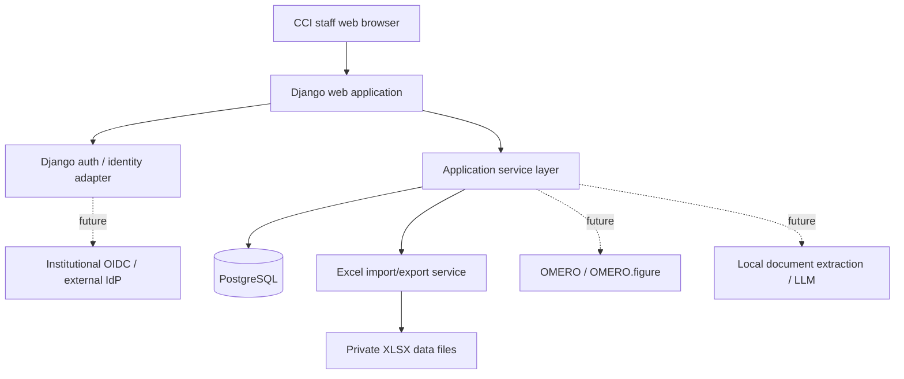

# Architecture, authentication, authorization, and UI

**Version:** v0.1 proposal  
**Date:** 2026-11-02  
**Status:** Local prototype baseline selected 2026-11-03; advanced UI and shared hosting follow workflow review

## 1. Proposed architecture



**Prototype baseline:** Django 5.2 LTS + PostgreSQL 17, server-rendered forms and a plain HTML table. Add HTMX or a table library after workflow testing demonstrates the need. See the [prototype-first roadmap](04_DEVELOPMENT_ROADMAP.md) for delivery gates and local authentication. Use Django admin for *internal administration*, not necessarily as the final staff-facing workflow. Alternatives previously considered (Grist/eLabFTW) may still be worthwhile if custom development proves too heavy, but the state-transition and permission requirements lean toward Django.

Why this stack:

- Python is familiar to CCI's technical staff and fits later OMERO and document-processing integration.
- Django provides ORM, migrations, forms, admin, sessions, authentication backends, CSRF support, and permission hooks.
- PostgreSQL provides reliable transactions and unique constraints for numbering and storage occupancy.
- A small staff-facing web UI can be designed for the six-person team rather than forcing all users to navigate database tables.

**Avoid needless infrastructure initially:** no microservices, message broker, search cluster, Redis, Kubernetes, or separate API gateway required for the first pilot. Docker Compose can be an optional deployment convenience, not a functional requirement. Expose an API only if a real integration needs it.

## 2. Code organization (suggested)

```text
config/                 # project settings / URL routing
registry/
  models/               # owners, sessions, grids, locations, events
  services/             # create_session, allocate_ids, move, clip, ship, discard, import
  selectors/            # authorized grid querysets and views
  forms/                # validated input / event forms
  views/                # staff web routes
  templates/registry/   # grouped forms, table, detail and history
  tests/                # models, services, permissions and views
accounts/               # user account config and owner-grant admin
imports/                # import parser, normalization, preview and report
```

This is a **suggestion**, not a strict directory mandate. Prefer a manageable repository structure over premature modularity. Centralize authorization and business rules to prevent inconsistent behavior between forms, table edits, and future API endpoints.

## 3. Authentication should be replaceable

**Initial pilot:** Django local user accounts, strong passwords, server-managed sessions, HTTPS for non-local deployment, administrators capable of creating/deactivating accounts. Only six CCI accounts are needed initially.

**Later:** OIDC or another standards-based institutional identity provider (possibly university SSO / Entra ID). BankID is used in some institutional contexts but should **not** become a hard dependency; international collaborators need non-Swedish options.

Keep a **stable internal AppUser ID** as the FK target. Associate external identities via a separately managed mapping rather than making email, BankID, or external subject IDs the primary key. If planning to use Django's custom user model, choose it **before running initial migrations**, because changing the user model afterward is expensive.

Do not enable external registrations automatically. For the future, a researcher account should require CCI approval and explicit assigned access.

## 4. Authorization and roles

**Owner-based grants**, not mandatory project membership:

- **Admin:** see/change all owners, sessions, grids, events and user/permission settings.
- **CCI staff:** read all grid records, regardless of owner; writing depends on an owner-specific grant or admin override (staff-wide editing rights are an open decision).
- **Owner viewer:** read assigned owner's grids (future external users).
- **Owner operator:** use approved lifecycle actions, but not change scientific preparation settings (future).
- **Owner editor:** may edit authorized owner grid preparation fields and actions allowed by policy.

### Proposed action matrix

| Action | Admin | CCI staff with owner editor grant | CCI staff with owner operator grant | Future owner viewer |
|---|---|---|---|---|
| View CCI grid registry | Yes | Yes (all CCI staff) | Yes (all CCI staff) | No; only assigned owners |
| Create owner and manage ID prefix | Yes | No | No | No |
| Create preparation session + grids | Yes | Yes | No | No |
| Edit preparation fields | Yes | Yes | No | No |
| Edit permitted preparation cells in bulk | Yes | Yes | No | No |
| Record store / move / clip | Yes | Yes | Yes | No |
| Record imaging / ship / discard | Yes | Yes | Yes | No |
| Change owner grant | Yes | No | No | No |
| Edit historical physical events | Controlled correction only | No | No | No |
| Import legacy workbook | Yes | No | No | No |

Final exact roles/permissions are **proposed**; they must be confirmed before exposing external access. In v0.1 only CCI accounts use them.

**Security requirements:**

- Verify action authorization in server-side service/view before data mutation; querysets must be filtered for restricted users.
- Bulk mutation must authorize **every target row**, reject the whole operation (or clearly report per-row failures with no hidden partial success), and maintain audit events.
- Avoid IDOR/insecure object references: guessing a grid number must not grant write access.
- Show explicit permission errors rather than silently dropping unauthorized changes.
- Use anti-CSRF protections, session expiry, secure cookies, HTTPS, and least-privilege DB credentials.
- Restrict admin endpoints, log permission changes, and keep production debug mode off.

## 5. Staff-facing UI versus Django admin

### Main registry table

- Fast search and filters: ID, owner, experiment ref, sample, date, available status, clipped status, location.
- Hide long preparation columns by default; expandable groups: **Identity**, **Preparation**, **Storage**, **Lifecycle**.
- Safe editable cells for scientific parameters only; IDs and derived status read-only.
- Bulk edit selected rows, with a preview showing *exact grids and old/new values* before confirming.
- Export filtered results with stable field names and explicit units.

### Session wizard

1. Owner selector.
2. Preparation date/operator, optional experiment/project reference.
3. Shared preparation fields (grouped, numeric units labeled).
4. Count of grids to generate.
5. Preview ID allocation and defaults.
6. Confirm atomic creation; redirect to editable generated-grid table.

### Grid detail

- Summary: immutable grid ID, sample owner, session, current clipping/availability/imaging states, location.
- Individual preparation field editing.
- Dedicated **Store**, **Move**, **Clip**, **Remove for imaging**, **Mark imaged**, **Return**, **Ship**, **Discard** actions.
- Chronological event history and separate database audit history (admin-only where appropriate).
- Notes and experiment reference.

### Admin

- Create/deactivate users, create owners and codes, assign/revoke grants, view import reports and audit records.
- Owner code and identifier sequence configuration. Avoid routine editing of allocated IDs.

## 6. Transactional domain services

Implement operations as testable service functions rather than putting state rules exclusively in view functions:

- `create_preparation_session_and_grids(...)` — capture immutable snapshot; allocate N IDs safely; create N independent grids; all or nothing.
- `update_grid_preparation(...)` / `bulk_update_grid_preparation(...)` — check owner grant, validate values, write audit history.
- `assign_storage(...)`, `move_grid(...)` — validate occupancy and lifecycle, append event, update current-state projection atomically.
- `clip_grid(...)` — mark clipped, record actor/time, optionally move to clipped location in same transaction.
- `remove_for_imaging(...)`, `record_imaging(...)`, `return_to_storage(...)` — keep imaging separate from disposal.
- `ship_grid(...)`, `discard_grid(...)` — remove from CCI available inventory, retain history.

Database transactions must guard against concurrent requests assigning the same slot or generating the same ID. Make service calls idempotent when requests can reasonably be retried (e.g., use a request idempotency token for session creation), to avoid accidental duplicate batches.

## 7. Audit / backups / operations

- Keep automatic created/modified timestamps, audited changes of scientific parameters, and append-only physical events.
- For imports, preserve the source filename/checksum, timestamp, row number, warnings, normalized values and original text (private access).
- Define PostgreSQL backups, retention policy, restore procedure and at least one tested restore before production use.
- Set appropriate access controls on exports and database backups. Avoid public source control for raw research records.
- Keep versions pinned, configuration externalized, and document local startup / deployment steps.

## 8. Future integration boundaries

- **OMERO:** store stable server/image/dataset/figure IDs when implemented; no image blobs in registry required.
- **Local LLM:** separate background extraction pipeline from authorization and scientific source-of-truth. Its output is a *proposal for human review*, not an automatic edit to validated preparation data.
- **Public protocol publishing:** internal structured protocol model may eventually be exported to protocols.io, but publication is not part of this grid MVP.
